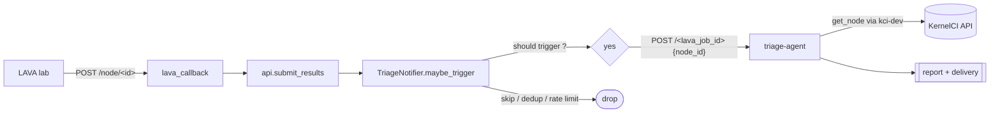

When a LAVA job fails, the pipeline can hand it to a separate
[triage-agent](https://github.com/) service for automatic root-cause
analysis. The pipeline's side of this is a trigger and nothing more: it
decides whether a finished job deserves triage, POSTs two identifiers, and
returns.

Everything after that belongs to the agent — resolving the KernelCI node
through [`kci-dev`](https://github.com/kernelci/kci-dev), fetching the log,
running the analysis, and delivering the report. `kci-dev` is the sanctioned
library for talking to KernelCI, so the pipeline does not stand up a second
integration path beside it. In practice that means this module needs no
KernelCI client, no credentials, and no knowledge of report formats.

The handoff is best-effort. `lava_callback` submits and moves on — it never
waits for the report, and a broken or unreachable triage-agent never causes
the LAVA callback to fail.

Sources:

- `src/triage_notifier.py` — the notifier module
- `src/lava_callback.py` — the callback that hooks the notifier

## Overview



`lava_callback` receives the LAVA callback, uploads log and artifacts to
storage, submits the results to the KernelCI API, and then calls into the
notifier. The notifier does nothing unless `TRIAGE_ENABLE=true` and
`TRIAGE_AGENT_URL` are set, so the integration is safe by default.

## What crosses the boundary

The request is `POST <TRIAGE_AGENT_URL>/<lava_job_id>` with a JSON body
carrying the KernelCI node id:

```json
{"node_id": "6a980789e41d7f97d6f1dcec"}
```

Both identifiers matter, and they are split deliberately:

| Identifier | Where | Why the agent needs it |
|---|---|---|
| LAVA job id | URL path | Fallback route to the log when the node carries no stored artifact, and the human-facing LAVA job link |
| KernelCI node id | Body | Lets the agent fetch the node and get the KernelCI-side picture — tree, branch, commit, platform, lab, and the log URL already in KernelCI storage |

`TRIAGE_MODEL` and `TRIAGE_MODEL_OPTIONS_JSON`, when set, are added to the
same body. Nothing else is sent: any node field the agent wants, it looks up
itself.

## Ownership split

| Concern | Owner |
|---|---|
| Deciding whether a job deserves triage | `triage_notifier` |
| Dedup, rate cap, back-pressure | `triage_notifier` |
| Fetching the KernelCI node | triage-agent, via `kci-dev` |
| Fetching the LAVA log | triage-agent |
| The analysis | triage-agent |
| Report storage, GitHub issue, email | triage-agent |

Delivery used to live here. It does not any more — configure it on the agent
(`TRIAGE_GITHUB_*`, `TRIAGE_SMTP_*`, `TRIAGE_EMAIL_*` in the triage-agent
repo's `.env.example`). Consequently the notifier no longer polls for the
report and there is no second, longer client timeout to keep in step with the
agent's own run timeout.

## When it fires

The notifier looks at the finished LAVA job and decides whether to dispatch:

| Job result | Any test failed | Infra error | Dispatch |
|---|---|---|---|
| `pass` | no | — | no |
| `pass` | yes | — | **yes** |
| `fail` | — | — | **yes** |
| `incomplete` | — | no | **yes** |
| `incomplete` | — | yes | no by default; **yes** if `TRIAGE_SKIP_INFRA_ERRORS=false` |

Even when the criteria say "dispatch", the notifier can still drop the run:

- **Dedup** — the same `node_id` was triaged within the last
  `TRIAGE_NODE_DEDUP_TTL_SEC` (default 3600s).
- **Rate cap** — `TRIAGE_MAX_PER_HOUR` limits dispatches per rolling
  hour. 0 = unlimited (default).
- **Back-pressure** — the notifier's own thread pool is full.

Back-pressure is checked before dedup and rate cap, so a dropped run does not
burn a dedup slot or a rate-limit token.

## Configuration

All environment variables. Read once when `lava_callback` starts.

### Enable and target

| Var | Default | Notes |
|---|---|---|
| `TRIAGE_ENABLE` | `false` | Master switch |
| `TRIAGE_AGENT_URL` | — | Base URL of the triage-agent |
| `TRIAGE_SUBMIT_TIMEOUT_SEC` | `30` | Covers only the submit POST. Nothing waits for the analysis |

### Filtering

| Var | Default | Notes |
|---|---|---|
| `TRIAGE_SKIP_INFRA_ERRORS` | `true` | Set to `false` to also triage jobs marked as infrastructure failures |

### Concurrency and de-duplication

| Var | Default | Notes |
|---|---|---|
| `TRIAGE_MAX_WORKERS` | `4` | Notifier's own thread pool |
| `TRIAGE_MAX_QUEUE` | `MAX_WORKERS × 4` | Back-pressure threshold |
| `TRIAGE_NODE_DEDUP_TTL_SEC` | `3600` | Per-node cooldown, in seconds |
| `TRIAGE_MAX_PER_HOUR` | `0` | Cap dispatches per rolling hour. 0 disables the cap |

### Model overrides

| Var | Default | Notes |
|---|---|---|
| `TRIAGE_MODEL` | agent's default | LiteLLM model string sent per request |
| `TRIAGE_MODEL_OPTIONS_JSON` | — | JSON object merged into `litellm.completion(...)` |

### Operator knobs on `lava_callback`

| Var | Default | Notes |
|---|---|---|
| `CALLBACK_DRY_RUN` | `false` | Skip storage upload and API submit inside `async_job_submit` — the flow still reaches the notifier. **Test-only** |

With `CALLBACK_DRY_RUN=true` no log is uploaded, so the node carries no
`lava_log` artifact and the agent falls back to fetching the log from LAVA
directly. That is expected, not a failure.

### Metrics

Exported through `GET /api/metrics` on `lava_callback`:

| Counter | Meaning |
|---|---|
| `triage_dispatched_total` | Submit accepted, `run_id` returned |
| `triage_dispatch_failed_total` | Submit failed (agent down, non-2xx, no `run_id`) |
| `triage_dropped_total` | Dropped by dedup or back-pressure |
| `triage_rate_limited_total` | Dropped by `TRIAGE_MAX_PER_HOUR` |

Outcome counters for the analysis itself live on the agent — the pipeline
stops observing a run once it is queued.

### Deployment note

No `TRIAGE_*` variable is declared in any compose file or Kubernetes
manifest; they all arrive via `env_file: .env` on the `lava-callback`
service. `kube/aks/lava-callback.yaml` sets only `KCI_API_TOKEN` and
`KCI_SETTINGS`, so triage cannot be enabled on the AKS deployment without
adding the variables there.

## Design notes

### Never break the callback

`maybe_trigger` catches every exception it can produce and returns
immediately. All work happens on the notifier's own thread pool.
`lava_callback` also wraps the call in its own try/except as a second line of
defence. The LAVA callback path stays green even if triage is misconfigured
or the agent is offline.

### Why a thread pool for one POST

The submit is a single HTTP request with a 30s timeout, but it still must not
run inline: `async_job_submit` executes on the shared 16-worker callback
executor, and an agent that accepts connections then stalls would occupy one
of those threads. The pool keeps that blocking off the callback path.

### Back-pressure uses an atomic counter

The notifier tracks queued + running work with its own counter, not the
private `ThreadPoolExecutor._work_queue.qsize()`. The private attribute is
not part of the CPython contract and can move between versions. The counter
also makes it easy to expose an in-flight gauge later.

### Ordering: back-pressure before dedup

The pool-full check happens before dedup and rate cap. Dedup is expensive to
undo — if a run dropped by back-pressure still burned a dedup slot, the same
node could not be retriaged for an hour after a burst. Cheap checks first.

## Related documents

- [`connecting-lab.md`](connecting-lab.md) — how a LAVA lab is wired
  to the pipeline (LAVA token, `notify.callback` block)
- [`pipeline-details.md`](pipeline-details.md) — the end-to-end
  pipeline flow that produces the callback events the notifier acts on
